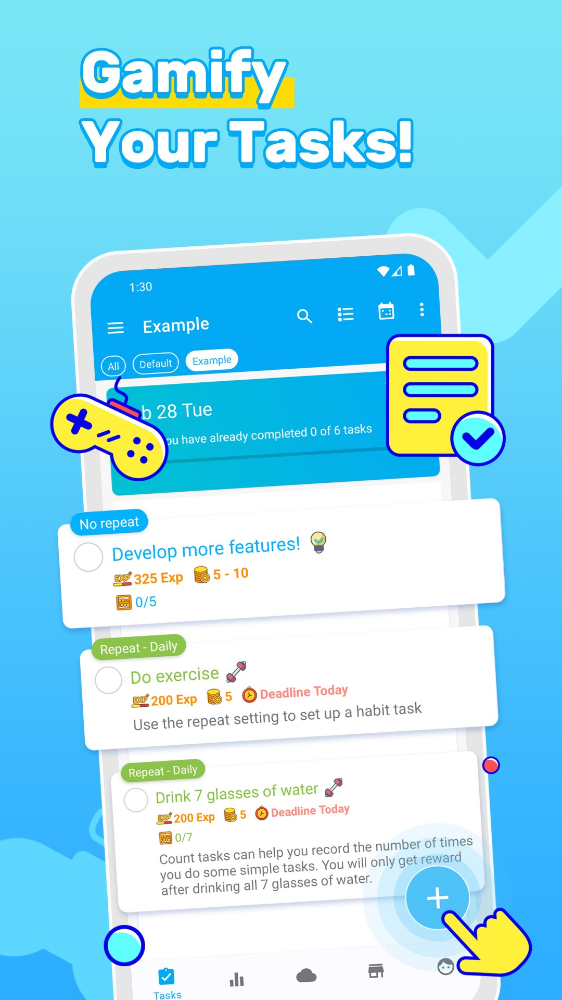
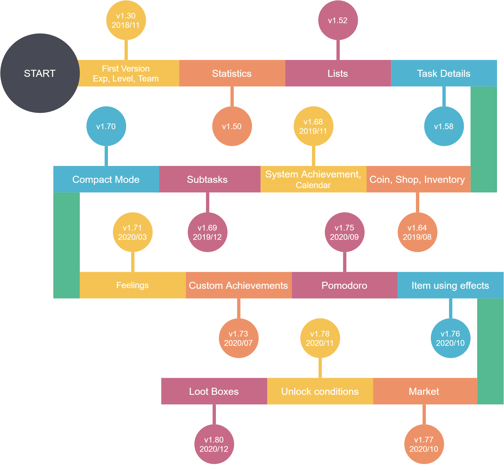
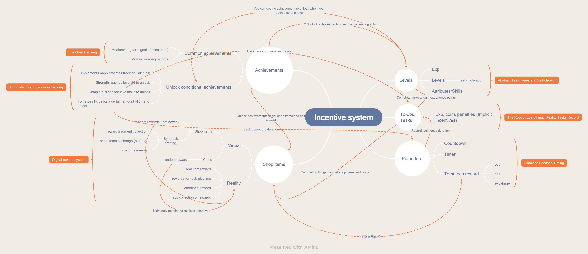
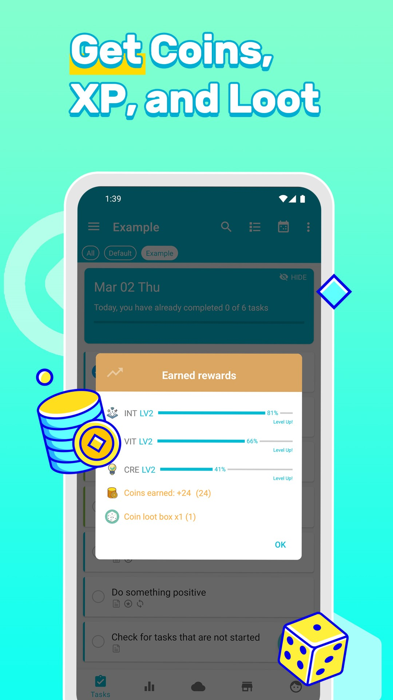
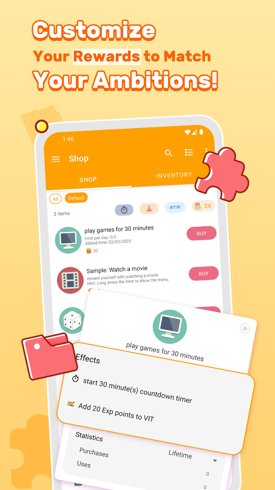
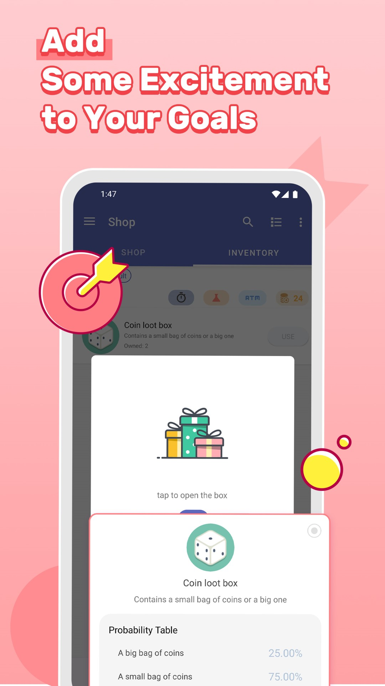
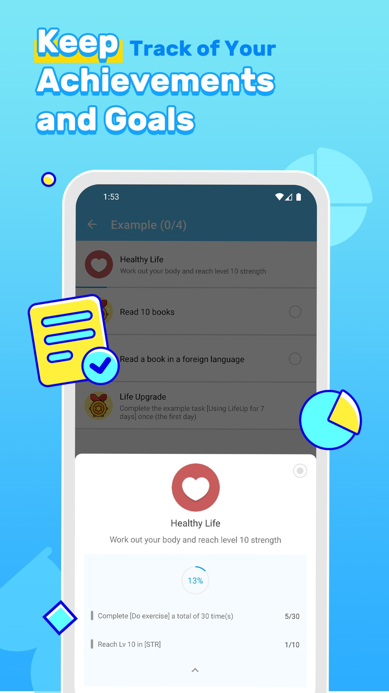
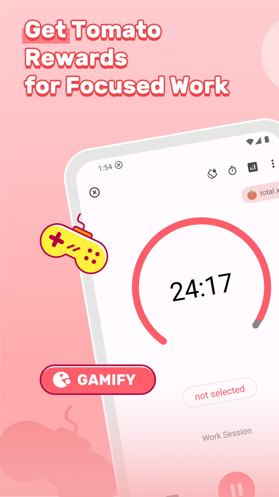
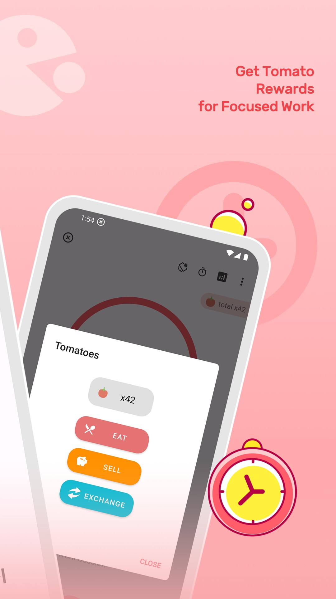
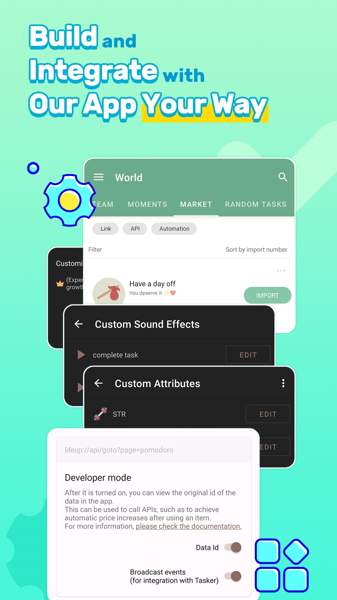

 

<h2 align="center" padding="100">LifeUp</h2>

Custom your own gamify list with attribute, exp, coin, reward to stay productive!

### Installation

  

  

🍎 We have also launched an alternative app for the iOS platform called `ulives`.

  

 

### What is this repository for?

| Purpose                                    | Description                                                  | Links                                                        |
| ------------------------------------------ | ------------------------------------------------------------ | ------------------------------------------------------------ |
| 📱 Introducing the app                      | This README will briefly introduce the LifeUp application.   | -                                                            |
| 🐛 Collect feedback and issues for the app. | We collect bugs and suggestions in the issues of this repository. | [Issues · GitHub](https://github.com/Ayagikei/LifeUp/issues) |
| 🚀 Release the trial version                | We will release a free trial version of LifeUp on the Release page. This is suitable for devices that do not support Google Play. | [Releases · GitHub](https://github.com/Ayagikei/LifeUp/releases) |
| 💬 Discussions                              | You can participate in discussions in our discussion forum.  | [Discussions · GitHub](https://github.com/Ayagikei/LifeUp/discussions) |
| 📌 Link to related repositories             | There are some open source projects around *LifeUp*, such as our SDK, desktop client, documentation library, and translation. | [LifeUp SDK/LifeUp Cloud](https://github.com/Ayagikei/LifeUp-SDK) [LifeUp Desktop🖥](https://github.com/Ayagikei/LifeUp-Desktop)  [LifeUp Documents📄](https://github.com/Ayagikei/LifeUp-Wiki) |
| 🌐 Link to community translation site       | LifeUp's multilingual text translation is contributed by community users, and we host the text on Crowdin. | https://crowdin.com/project/lifeup                           |

 

### Description

  

**Want a gamified , unique and fun to-do & habit-tracking app to stay motivated, organized, and focused?**

LifeUp is a unique gamify to To-Do list & habit app.

- Record and complete tasks to gain exp and coins, just like turn your life into an RPG and productivity game.

- Exp can improve your attributes and skill levels. And it will reflect your self-improvement.

- Use coins to buy the item you want to reward yourself. This can be used for you to balance your
  work and rewards, and to improve your focus.

- Set up achievements to auto-track your task progress and goals.

- More! Pomodoro, Feelings, custom loot boxes and there's even a crafting feature!

This is the gamification of your life, and you can customize your own gamification list and
reward/penalty syetem for optimal motivation, which may be helpful for ADHD.

---

## SDKs

We're developing an SDK so you can integrate with LifeUp.

Currently we have open-sourced "LifeUp Cloud" - it turns your phone into a server so you can
integrate with LifeUp from other devices (like your computer).

For example, you can use Python to write software to call LifeUp to complete the task. Or write a
simple web page to create a new task.

In the future, we will also provide an interface for querying data.

Please check [Ayagikei/LifeUp-SDK (github.com)](https://github.com/Ayagikei/LifeUp-SDK) for details.

---

## Timeline

---

## Incentive system

---

## Features 

🎨 **Attribute or skills**

Instead of build-in attributes such as strength, knowledge, etc.
You can also create your own skills such as fishing, writing.
Try adding tasks to your skills and leveling them up!
Track your level with achievements to unlock exclusive rewards when you reach the goal.
The growth of attributes and skills in the application is also equivalent to digitally reflecting your growth, prompting you to stay more motivated and powerful.

🎁 **Shop**

Abstract your task reward into the app as a shop item, whether it is a realistic reward, a reward for rest and entertainment time, or a stat reward in the app, such as taking a 30 mins break, watching a movie, or getting a random coin reward.

🏆 **Achievements**

In addition to dozens of built-in achievements waiting for you to unlock, you can create your own to track your progress: such as auto tracking the number of task completions, levels, and item usage times.
Or create your realistic milestones like arrived in a city!

⏰ **Pomodoro**

Use the Pomodoro to stay connected and stay motivated.
As a Pomodoro timer is completed, you can receive a virtual 🍅 reward.
Decide whether to eat or sell 🍅? Or exchange 🍅 for other item rewards?

🎲 **Loot boxes**

You can set the Loot boxes effect for the shop item to receive a random reward.
Are you wondering if the reward for completing a task is 🍔 or 🥗 ?

⚗️ **Crafting**

Create your custom crafting recipe.
In addition to being able to make sticks out of wood, you can try 🔑+lcoked chests= reward chests, or create your own currency.

🎉 **One-time payment, No IAPs releated to features, No Ads**

🔒️ **Offline first, but supports multiple backup methods**

We value your privacy!
The data is basically only stored locally on your phone and will not be transmitted to our server.   And there is an offline mode.
You can use Google Drive/Dropbox/WebDAV to sync your data, or export data locally for backup.

📎 **Complete to-do basic functions**

Repeats, reminders, notes, deadlines, history, checklists, attachments, and more.
Write down your to-dos and LifeUp will help you keep track of them.

What's more, you can gamify your routine to-do list in LifeUp with tons of custom reward options.

🤝 **World module**

You can browse or join task teams created by others.
Complete tasks together and post your updates!
Or browse and import a variety of shop item rewards settings and random tasks.

🚧 **More features!**

- App widgets
- Dozens of theme colors
- Night mode(dark theme)
- Lots of statistic
- Feelings
- Keep updating...

## More screenshots

 
 >
 
 
 
 
 

---

## Repository

### Closed source

Sorry about that *LifeUp* is not open sourced anymore since 17 May 2019 when someone package it with inserting some harmful ads and put the tampered version on some app market.

Some other reasons:
- There is still a lot of old code that has not been refactored
- Most of the code comments are not currently written in English and are not universal enough
- Some code involving secure is not convenient to open source

We're planning to *partially* open source in the future.

 

### Issues

**Please feel free to open issues about your questions, the problem you encountered and feature requests.**

 

### Translations

We expect to publish the application in multiple languages, but due to limited resources, it is difficult to request a professional translation.

Therefore, the translation of the application has always been contributed by community users.
We recently hosted the translation of the application on the Crowdin platform.

If you are interested in translating or proofreading, you can check here:

[Ayagikei/LifeUp-Translation: The raw text resource of LifeUp. Welcome to contribute more language! (github.com)](https://github.com/Ayagikei/LifeUp-Translation)

 

### Documents

With the addition of application functions and the increased usage costs brought about by the high degree of freedom, we plan to maintain a usage document.

The content is still rough, and contributions are welcome.

[Ayagikei/LifeUp-Wiki: The documents of LifeUp. (github.com)](https://github.com/Ayagikei/LifeUp-Wiki)
